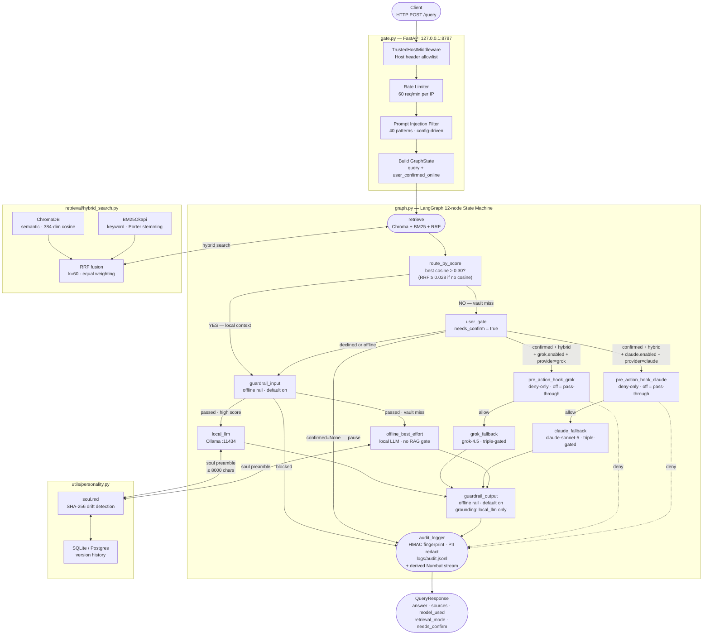

# CyClaw

[](https://www.python.org/)
[](requirements.txt)
[](requirements.txt)
[](https://github.com/cgfixit/CyClaw/actions/workflows/ci.yml)

[](https://github.com/cgfixit/CyClaw/tree/main/docs/screenshots)

[Watch the 60-second demo (MP4)](docs/screenshots/demo/cyclaw-60-second-demo.mp4)
— silent, with real local retrieval and inference using synthetic documents.

CyClaw answers questions from **your documents on your hardware**. Its
12-node LangGraph retrieves first and audits every path,
and requires per-question consent for paid Grok or Claude fallback. The
server binds to `127.0.0.1:8787`.

- Embeddings, BM25, and the cross-encoder run locally on CPU; cache both
  retrieval models before going offline.
- Soul, ops, memory, and audit routes require [operator access](#api-key-setup-soul-mutations),
  which fails closed without `CYCLAW_API_KEY` (an enabled admin's login also
  works when per-user auth is on).
- Audit records hash questions by default; the spend ledger records billed
  tokens; `cyclaw-metrics` reads both offline.
- Guardrails (NeMo in every base install), the Numbat stream, and the spend
  ledger ship on. Auth, memory, connectors, and the Telegram/X channels ship
  off.

CyClaw serves one trusted operator, or a mutually trusted group with auth
enabled; it provides neither tenant isolation nor a microVM
([threat model](docs/THREAT_MODEL.md)).

Install and API recipes: [Setup Guide](setup-guide.md).
Contributor contracts: [`CLAUDE.md`](CLAUDE.md), [`AGENTS.md`](AGENTS.md),
[Codex guidance](.codex/README.md), [Actions guide](.github/workflows/README.md).
Install the [Git hooks](docs/GITHOOKS.md) with `bash scripts/ensure-githooks.sh`;
verify `git config --show-origin --get core.hooksPath` selects `.githooks`
unless an existing hook manager was preserved. [Hook file guide](.githooks/README.md).
[Residual security decisions](SECURITY.md#issue-1526-residual-decisions-2026-10-12)
record accepted limits and research; native Windows verification remains disabled.

Confirmed fallback sends questions externally. Context stays local unless
`policy.fallback.send_local_context_to_grok` or `send_local_context_to_claude`
is enabled; soul content is never added. Model downloads and optional
sync/channels have separate connections. For no-egress use, pre-cache models,
disable optional connections, and enforce an external network boundary.

## Quick Start

**macOS (Apple Silicon)** — install, keys, Ollama, index, and startup:

```bash
git clone https://github.com/cgfixit/CyClaw && cd CyClaw
bash macos/setup-cyclaw.sh
```

**Linux** — Ollama already running on `127.0.0.1:11434`. The shipped MLX
model tag targets Apple Silicon. Before starting the gateway, set both
`models.local_llm.model` and `guardrails.model` in `config.yaml` to the
Linux-compatible tag you pull below (or another installed model that fits
your hardware):

```bash
git clone https://github.com/cgfixit/CyClaw && cd CyClaw
python3.12 -m venv .venv && source .venv/bin/activate
pip install --require-hashes --no-deps -r locks/requirements-torch-lock-linux.txt --index-url https://download.pytorch.org/whl/cpu
pip install --require-hashes -r locks/requirements-lock-linux.txt
pip install --require-hashes -r locks/requirements-test-lock-linux.txt
ollama pull qwen3.8:27b
export CYCLAW_API_KEY="$(openssl rand -hex 20)"  # operator routes; /query uses sessions/tokens when auth is on
python -m retrieval.indexer                      # once; without this, /query is 503
python gate.py                                   # http://127.0.0.1:8787
```

CI checks every lock group against recorded inputs and hashes, and checks wheel dependency metadata. Refresh on arm64 macOS with the [maintained lock scripts](setup-guide.md#lock-freshness-and-refresh-failures); generation failures leave tracked locks unchanged.

**Windows** uses the same pins with the `-windows` lock files
(`py -3.12 -m venv .venv`, `.\.venv\Scripts\Activate.ps1`):
[Windows](setup-guide.md#windows-powershell), [Linux](setup-guide.md#linux-bash).
Choose a non-MLX local model and update both model keys there as well.

Confirm: `curl http://127.0.0.1:8787/health`, then open
`http://127.0.0.1:8787/`. A manual macOS install uses plain `torch==2.14.1`
(no `+cpu` wheel) then the hashed macOS lock
([macOS (Apple Silicon)](setup-guide.md#macos-apple-silicon)); updating an
existing environment ends with the [NeMo verification](setup-guide.md#verify-the-installed-nemo-runtime).

---

## For newcomers

**Python and install paths.** Use Python 3.12 (`>=3.12,<3.13`):
[macOS](macos/README.md), [Windows](powershell/README.md), Linux above,
[Docker](docs/DOCKER.md) (`linux/amd64`, loopback), or conda (`environment.yml`).
The [constrained editable install](setup-guide.md) adds `cyclaw-*` commands;
source checkouts use `python gate.py` and `python -m retrieval.indexer`.
[Lock maintenance](locks/README.md).

**Secrets.** `gate.py` reads environment variables, never dotenv files
(`Invoke-CyClaw.ps1` reads only non-secret settings from an owner-only
`%USERPROFILE%\.CyClaw\.env` or checkout dotenv).

**Secret persistence.**

| Platform | Setup | Operation | Default secret store | Plaintext opt-in |
|---|---|---|---|---|
| macOS | `macos/setup-cyclaw-keys.sh` | Set up or preserve gateway key | Keychain | `--write-env-file` |
| Windows | `powershell/Install-CyClaw.ps1` | Migrate existing plaintext secrets | Credential Manager | `-WriteEnvFile` |

On Linux, `macos/invoke-cyclaw.sh` stores the gateway key in libsecret or an
owner-only file (`macos/cyclaw-linux-key.sh`). Services read secrets at
execution through `macos/cyclaw-keychain-env.sh` or
`powershell/CyClaw-CredMan-Env.ps1`, never from dotenv, plist, task XML,
`config.yaml`, shell rc files, or argv; a configured keystore lookup fails
closed when its item is missing. A missing provider key leaves that provider
unavailable, not the server down ([provider keys](spend/README.md#api-keys)).

**Offline and hybrid.** Shipped `app.mode: hybrid` needs an enabled,
available, selected provider and per-request confirmation for paid fallback.
Offline mode or declining stays local. Downloads have separate controls:
`models.embeddings.offline_after_index: true` requires cached embeddings;
pre-cache the ~91 MB reranker before its first query.

**Ports.** Gateway `127.0.0.1:8787` (`api.port`, launcher
`CYCLAW_GATE_PORT`), Ollama `127.0.0.1:11434`. The retired `:8790` console
became [CG-agent-harness](https://github.com/cgfixit/CG-agent-harness).

**First-run checks and limits.**

- `503 INDEX_NOT_FOUND`: run `python -m retrieval.indexer` or **Build my
  library** (`POST /index/build`, `GET /index/status`). Build requires
  loopback, same-origin, no forwarding headers; configured keys require unlock.
- Console mode and Library/Engine chips expose readiness. `/health: degraded`
  usually means Ollama is down; startup `TELEMETRY KILL` is expected.
- External health probes ship off (`api.health_probe_external_providers`).
  Key presence/model readiness does not establish successful generation.
- Per-IP rate limit: 60/min, reset on restart unless `api.rate_limit.persist_path`
  or Postgres persists it. `/health` and `/index/status` are public/unlimited.
  Bodies above `security.max_request_body_bytes` (1 MiB) return 413.
- CORS allows `http://127.0.0.1:8787` and `http://localhost:8787`;
  `/query` rejects cross-site requests. Restart after sanitizer-config edits.
  `CYCLAW_EMBED_CACHE_SIZE` (2048) is an environment variable.
- Run `python .claude/skills/invariant-guard/check_invariants.py` and
  `python .claude/skills/doc-sync/doc_sync.py`; exercise changed behavior.
  [Hosted CI owns broad suites](tests/README.md).
- At `api.max_concurrent_queries` (4), `/query` returns `503 GRAPH_BUSY`;
  exceeding `api.graph_timeout_sec` (780 s) returns `504 GRAPH_TIMEOUT`.


**Local records.** Paths are relative to the repository.

| Path | Git status | Contents and behavior |
|---|---|---|
| `logs/audit.jsonl` | ignored | Authoritative audit, written synchronously on the request thread. Questions use persistent HMAC-SHA256 fingerprints by default, including when `logging.audit_fields` is absent or empty. Explicit `include_query_hash: false` stores redacted query text |
| `logs/spend.jsonl` | ignored | Tokens for billed Grok/Claude calls, without query text or prices |
| `logs/numbat-events.ndjsonl` | ignored | Derived redacted audit and out-of-band events; observation only |
| `logs/cyclaw.log` | ignored | Application log; a bounded writer drops records rather than holding a request on stalled I/O |
| `logs/evals/` | ignored | Opt-in dogfood and judge output, separate from production billing |
| `index/` | ignored | Chroma and `bm25.json`; rebuild after corpus changes |
| `data/personality/soul.md` | tracked | Changes appear in `git status` and broad staging |
| `data/personality/cyclaw_soul.db` | ignored | Version DB; not yet generated in a clean checkout |
| `data/personality/soul.md.bak` | ignored | Vetted backup; not yet generated in a clean checkout |

Day-two:

```bash
python -m metrics                           # spend, audit aggregates, sequences
python -m retrieval.clear_cache             # dry-run; --apply deletes .emb_cache
python -m retrieval.indexer                 # rebuild after editing data/corpus/
curl -s http://127.0.0.1:8787/index/status   # build progress
```

---

## What It Does

CyClaw retrieves Markdown and `.txt` documents before generation. Output
rails enforce a token-overlap floor on retrieved local answers; that heuristic
does not verify individual claims, which the [evals](docs/EVALS.md) measure.

1. **Retrieval first.** `retrieve` starts the 12-node graph; a miss can still
   reach `offline_best_effort` with partial context.
2. **Hybrid search.** ChromaDB and BM25 fuse through RRF (`retrieval.rrf_k`).
   A vault hit needs the best cosine to clear `retrieval.min_semantic_score`
   (without cosines, the fused score must clear the RRF-scale
   `retrieval.min_score`); the cross-encoder runs in shadow mode
   (`retrieval.min_rerank_score: null`). [Retrieval reference](retrieval/README.md).
3. **Local generation.** Ollama uses `models.local_llm.model` (shipped
   `qwen3.8:27b-mlx`). Tune context/sampling for your hardware in `config.yaml`.
   An optional [derived tag](docs/%21%20How-To-Guides/OLLAMA_SETUP.md#pin-the-context-window-with-a-derived-tag)
   stores `num_ctx`; `macos/Modelfile.cg` builds the unpublished
   `qwen3.8:27b-mlx-cg`. Keep a suffix to avoid overwriting the registry tag.
   Local bearer tokens come from `models.local_llm.api_key_env` or
   `models.local_llm.fallback.api_key_env` (defaults `CYCLAW_LOCAL_LLM_API_KEY`
   and `CYCLAW_LOCAL_LLM_FALLBACK_API_KEY`). Unset means no auth header.
   Startup rejects inline `api_key` values, including in disabled fallback.

4. **Governed soul.** `data/personality/soul.md` has SHA-256 drift detection
   and atomic writes; `POST /soul/apply` requires a human `reason` and an
   enforced injection scan. Restore audits an advisory scan of the vetted
   backup without enforcing it; `/soul/reload` and startup drift recovery adopt
   on-disk content unscanned. A missing soul self-initializes
   ([Soul invariants](INVARIANTS.md), Rules 4–5).
5. **Confirmed external fallback.** Grok (`grok-4.5`, `api.x.ai`) or Claude
   (`claude-sonnet-5`, `api.anthropic.com`) needs hybrid mode, that provider
   enabled and selected, `user_confirmed_online: true` on the request, and a
   key. Calls share the remaining `api.graph_timeout_sec` budget, and
   `utils/endpoint_trust.py` rejects rewritten provider URLs.
6. **HTTP and MCP.** FastAPI serves the browser at `/`; the separate MCP
   server exposes sanitized retrieval only (`sampling: None`, no generation).
7. **Audit convergence.** Every path converges at `audit_logger` before END;
   `cyclaw-metrics` reads the audit offline.

[Six invariants](CLAUDE.md#3-the-six-invariants) include core import isolation;
[`INVARIANTS.md`](INVARIANTS.md) maps Rules 1–9 to tests.

**Storage/console.** Embedded `chroma` defaults, optional `pgvector`
(`indexing.vector_backend`); BM25 uses JSON, never pickle. `static/terminal.html`
provides queries, first-run build, health, Soul/Sync/Filesystem panels,
and authenticated Users/Audit.

### Optional layers at a glance

| Layer | Purpose | Ships |
|---|---|---|
| [Per-user auth](#per-user-authentication) | Passwords, sessions, device tokens, roles | off |
| [Memory](docs/memory/README.md) | SQLite/FTS5 facts and episodes, propose/apply, optional retrieval fusion and HTML export | off |
| [NeMo Guardrails](#nemo-guardrails) | Deny-only input/output checks, deterministic fallback on NeMo failure | on |
| [Dropbox sync](docs/SYNC_README.md) | Out-of-band `rclone` corpus pull | CLI |
| [Connectors](docs/agentic/AGENTIC_README.md) | Scoped filesystem, passive LAN inventory | off |
| [Telegram](docs/channels/TELEGRAM_DESIGN.md) / [OpenTweet](docs/channels/OPENTWEET_DESIGN.md) | Phone remote and X drafts through loopback `/query` | off |
| [Numbat stream](docs/security-philosophy/numbat_secondary_evaluator.md) / [pre-action hook](docs/security-philosophy/numbat_pre_action_gate.md) | Derived NDJSON, observation only; deny-only gate before a confirmed external call | on / off |
| [Spend ledger](#spend-tracking) | Billed token counts | on |
| [Fine-tune kit](tools/lora_finetune/README.md) | Separate QLoRA toolkit | toolkit |

---

## Architecture

`gate.py` initializes the soul at startup; requests pass the body cap, Host
allowlist, any required authentication, the 60/min per-IP limit, and the
injection filter (in that order), then enter the graph as `GraphState`.



The MCP server calls the retriever directly after sanitization and never
enters this gateway or graph. The diagram omits the per-answer NeMo `check()`
and the post-graph CEL monitor ([Optional layers](#optional-layers)).

---

## API Key Setup (Soul Mutations)

`/soul/*`, `/ops/*`, `/memory/*`, `/query/export/html`, and `/audit/summary`
require operator access. `/health` is public; `/query` requires a session
or device token when `auth.enabled` is true. Operator credentials are:

- **Bearer `CYCLAW_API_KEY`**, for HTTP clients and scripts (compared with
  `hmac.compare_digest`).
- **The console cookie.** "Unlock operator tools" trades the key once for
  an HttpOnly, `SameSite=Strict` cookie (`security.console_session_ttl_sec`,
  1 h shipped); "Lock" deletes it with matching TLS attributes, and rotating the key revokes every cookie.
- **An admin login**, when `auth.enabled` is on (no key needed); `operator`
  and `audit` accounts do not get operator access.

Cookie writes require CSRF; cross-site requests fail. Tokens bind origin;
TLS uses `__Host-` cookies. Because cookies lack port isolation, use a dedicated
TLS hostname alongside untrusted services. Without `CYCLAW_API_KEY`, key/cookie
access fails closed; enabled admin sessions still work.

`macos/invoke-cyclaw.sh` and `powershell\Invoke-CyClaw.ps1` generate a
missing key into the OS keystore and open a single-use `#pair=...` unlock
link (5 minutes). To unlock by hand, copy the key into the dialog:

```bash
# macOS
security find-generic-password -a "$(whoami)" -s com.cgfixit.cyclaw.api-key -w | pbcopy
```

```powershell
# Windows, from the CyClaw folder
. .\powershell\CyClaw-SecretStore.ps1; (Read-CyclawCredential com.cgfixit.cyclaw.api-key).Secret | Set-Clipboard
```

Do not persist the key with `setx` or a user environment variable; the
launchers read it from the keystore into the gateway process only
([`powershell/README.md`](powershell/README.md#secret-classification)).
Rotation, the macOS bootstrap, and 401 recovery:
[`macos/README.md`](macos/README.md#key-bootstrap).

`security.api_key_optional` ships `false`; when set, a request skips the key
only if the socket peer is loopback, no forwarding header is present, and the
request is not cross-site (inert under Docker NAT). It does not disable
per-user authentication or RBAC. Full boundary:
[`INVARIANTS.md`](INVARIANTS.md) Rule 6 and the
[threat model](docs/THREAT_MODEL.md) (fourteenth amendment).

## Per-User Authentication

Separate from the operator API key. `gate_auth.py`: scrypt passwords, a
session cookie plus CSRF for browsers, named device tokens for scripts, roles
`admin`, `operator`, and `audit`. Ships `auth.enabled: false`; while off,
every `/auth/*` route returns 503. Assigned roles survive restarts, including
demotions of the bootstrap account. Design, TLS, and the non-loopback bind
rule: [`docs/AUTHENTICATION_DESIGN.md`](docs/AUTHENTICATION_DESIGN.md);
first-boot `curl` and `cyclaw-user`:
[`setup-guide.md`](setup-guide.md#authentication-routes-auth-off-by-default).
`cyclaw-gen-cert` writes the self-signed cert for the auth + TLS bind exception.

---

## Spend Tracking

Billed Grok/Claude calls append tokens to `logs/spend.jsonl`; dollars are
computed at read time, so rate-card fixes re-price history. Rows exclude
queries, prompts, and keys, and a failed write drops the row, not the answer.
Core Grok/Claude requests also reserve a durable call allowance before each
POST attempt, retries included: 100 per UTC day and 1,000 per UTC month by
default (zero denies all). Dollar spend is not enforced.

| `source` | Writer | Covers |
|---|---|---|
| `query` | `llm/client.py` | Confirmed `/query` fallback |
| `agentic` | none since October 2026 (the agentic coding loop was removed) | Historical rows only; still parsed and reported |
| `eval` | `tests/judge_eval.py` | Opt-in judge runs, kept separately under `logs/evals/` |

`python -m metrics` reports `today` and `last_7d` tokens and USD by provider
and source, and its forensic Sequences section flags a blocked injection
followed within 15 minutes by a paid call (no policy enforced).
`tests/spend_live_probe.py` **spends real money** and is opt-in only.
[Ledger schema, rate bands, and probes](spend/README.md).

---

## Benchmarks and Evals

Only the retrieval gate blocks merges; none of these four paths is a graph
node or a security control. [Thresholds and limits](docs/EVALS.md).

| Evaluation | Command | Scope |
|---|---|---|
| Retrieval gate | `python -m tests.ci_rag_smoke` | Every PR, no LLM. Corpus probes through `route_by_score_node`, then hit@5, Recall@5, and MRR on the 52-case fixture (44 scored, 8 out-of-corpus skipped). Metric floors and `[FILTERED]` injection-chunk assertions block CI |
| Local dogfood | `CYCLAW_EVAL_DOGFOOD=1 python scripts/cyclaw-eval-dogfood.py` | Opt-in real loopback model, one case per category ([recipe](tests/fixtures/groundedness/DOGFOOD.md)) |
| Anthropic judge | `CYCLAW_EVAL_LIVE=1 python tests/judge_eval.py` | Paid opt-in Claude grades groundedness, completeness, abstention |
| Local judge | Same command with `evals.local_judge.enabled: true` | Same rubric on a second loopback model with a different configured tag; choose a separate family and calibrate it |

Fixture retrieval scores 1.0 on all three metrics (no claim about arbitrary
corpora). The [reranker bake-off](docs/audits/2026-09-26-reranker-bakeoff.md)
found no passing threshold, so vetoing stays off. The only published local run
is the [Qwen dogfood audit](docs/audits/2026-09-12_Local_Qwen_Dogfood_Matrix.md);
no judge result is published yet.

---

## Current development

Current changes and dated decisions live in the
[merged PRs](https://github.com/cgfixit/CyClaw/pulls?q=is%3Apr+is%3Amerged)
and [`docs/changelog.txt`](docs/changelog.txt). Install and contributor
contracts: [locks](locks/README.md), [Git hooks](docs/GITHOOKS.md).

---

## Optional layers

**Dropbox sync.** Out-of-band `rclone` pulls into `data/corpus/`, bounded by
deletion/transfer limits and a single-instance lock; exit 10 requests reindex.
Run `python -m sync.cli setup`, `test`, `sync --dry-run`, then `sync`.
Status/scheduling: [CLI guide](docs/SYNC_README.md),
[walkthrough](docs/%21%20How-To-Guides/Dropbox_Sync_Guide.md).
Generated schedules load encrypted-config passwords from OS keystores.

**Native scheduling.** Plist/task generators print activation commands;
token-bearing jobs use keystore wrappers. Supervised gateway generators
(`macos/generate_service_plist.py`, `windows/generate_service_task.py`)
require `--confirm` and a nonempty `--reason`.
[Operations](macos/README.md), [design](docs/work/MACOS_LAUNCHD_INTEGRATION_PLAN.md).

**Fine-tuning.** The [separate QLoRA toolkit](tools/lora_finetune/README.md)
is excluded from runtime installs. Its CUDA training profile is currently
blocked by dependency conflicts; CPU preparation/dry runs remain available:
`python tools/lora_finetune/build_cyclaw_corpus.py`, then
`python tools/lora_finetune/dryrun_finetune.py`. Training may download a
checkpoint; pre-cache before no-egress use.

**Connectors.** Default-off, out-of-band `fsconnect` offers bounded reads
and gated writes (refused on Windows); `netconnect` inventories explicit
RFC1918/loopback CIDRs passively. Neither calls an LLM.
[Removed October 2026 components](docs/agentic/AGENTIC_README.md#8-removed-in-october-2026).

```bash
python -m agentic.fsconnect.cli status
python -m agentic.netconnect.cli status
```

[Filesystem](docs/agentic/AGENTIC_README.md#2-filesystem-connector-agenticfsconnect),
[passive network](docs/agentic/AGENTIC_README.md#3-passive-network-connector-agenticnetconnect),
and the [package map](agentic/README.md).

### NeMo Guardrails

`guardrails.enabled: true` ships in `config.yaml`; explicit `false` or an
absent block disables it. `utils/guardrail_bridge.py` is the graph's only path
to `guardrails/`.

| Guard | Scope and refusal |
|---|---|
| Offline graph input | Local and best-effort paths; returns `block_message` through `audit_logger` without a model call |
| Offline graph output | `local_llm` only; replaces answers below `hallucination_threshold` (0.18) or matching soul-leak markers |
| NeMo `check()` | Wraps all four answer nodes (`nemoguardrails==0.24.1`); input refusal skips generation, output refusal replaces the answer |
| Broker fallback | Missing, failed, or unsupported live verdicts run deterministic input and soul-leak checks on every answer route; grounding stays `local_llm` only |

Active rails are Python checks and add no model calls; NVIDIA's
model-assisted `self_check_*` rails are inactive. NeMo failures audit
`guardrail_degraded`. Verify an install with `python -m pip check` and
`python -m guardrails.verify_install` ([setup guide](setup-guide.md#verify-the-installed-nemo-runtime),
[package guide](guardrails/README.md), [NeMo reference](docs/NeMo/README.md),
[Track B record](docs/audits/2026-10-03-nemo-track-b.md)).

### Numbat

CyClaw calls the external CLI pinned at 0.2.0 (schema 0.3.0); it never
vendors or imports it.

| Piece | Switch | Default and behavior |
|---|---|---|
| Stream | `numbat.enabled` | On. `utils/numbat_emitter.py` writes redacted audit/out-of-band events to `logs/numbat-events.ndjsonl` (rolls at 50 MiB); its bounded writer cannot hold requests |
| Pre-action hook | `policy.fallback.pre_action_hook.enabled` | Off. Prepared with `engine: numbat` and monitor-only rules in `config/numbat/gate/`; after consent, `rules test --no-builtin-rules` denies enforcing matches and every engine failure |
| CEL monitor | `numbat.cel.enabled`, extra `numbat-cel` | Off. Two structured-field rules observe weak-retrieval cloud answers and hook/guardrail refusals after `/query`; never blocks |
| Offline scoring | None | Operator CLI and `numbat-rules.yml`; fixture, stream-contract, and CEL checks block CI |

Nothing scores the live file during a request. The CLI and CEL extra are not
in standard installs: keep their switches off until installed (an enabled hook
without the binary denies every confirmed external call), trial rules before
promoting any to `enforce: true`, and never use `numbat hook` as the command
engine (it exits 0 on errors). Once enabled, `/health` reports hook and CEL
readiness and `/audit/summary` shows `pre_action_hook_last_verdict`.
[Pre-action gate](docs/security-philosophy/numbat_pre_action_gate.md),
[stream](docs/security-philosophy/numbat_secondary_evaluator.md),
[phase status](docs/plans/NUMBAT_AND_ALWAYS_ON_ROADMAP.md), and the
[Track A acceptance record](docs/audits/2026-10-03-numbat-track-a.md).

### Telegram and OpenTweet

Both ship off and call loopback `POST /query` outside the core graph imports,
reading credentials from the environment variable named in config. Telegram
offers outbound `notify` or long-poll `chat` (no public webhooks), requires
non-empty `allowed_chat_ids`, and can confirm one paid call only through the
exact `/online on <grok|claude>` command with `allow_hybrid_confirm` on
(default off); the triple gate still applies. OpenTweet forces
`user_confirmed_online: false` and writes drafts; `scheduled_date` needs
`opentweet.schedule_enabled`, and schedulers never send `publish_now`. Check
either with `python -m telegram.cli status` / `python -m opentweet.cli status`.
Telegram [design](docs/channels/TELEGRAM_DESIGN.md) and
[operations](telegram/README.md); OpenTweet
[design](docs/channels/OPENTWEET_DESIGN.md) and [operations](opentweet/README.md).

---

## Security Model

| Layer | Mechanism |
|---|---|
| Network | Binds `127.0.0.1:8787`; request bodies capped at 1 MiB (`security.max_request_body_bytes`). A non-loopback `api.host` is refused except the documented auth + TLS path, or `CYCLAW_ALLOW_NON_LOOPBACK_BIND` ([bind guard](docs/AUTHENTICATION_DESIGN.md#7-interaction-with-the-main-bind-guard-825)) |
| Endpoint trust | Local nodes: loopback or an exact host in `models.local_llm.trusted_hosts` (ships `[]`). Online nodes: `api.x.ai` and `api.anthropic.com` only |
| Input | `policy.prompt_filter`: 40 `banned_patterns`, `max_input_chars`; same filter on MCP search |
| Rate limit | 60 req/min per IP, after same-origin rejection and before the filter; in-memory unless SQLite or Postgres is set |
| Proxy bypass | `httpx` clients set `trust_env=False` |
| Telemetry | Kill maps before any SDK import (invariant-guard G1), plus ONNX's post-import call; not a network firewall ([`SECURITY.md`](SECURITY.md)) |
| Audit | HMAC-SHA256 query fingerprint + redacted metadata in `logs/audit.jsonl`, then the derived Numbat stream |
| Grok / Claude | [Triple gate](#what-it-does) item 5, then the opt-in deny-only pre-action hook |
| Soul writes | Human `reason` + enforced scan + atomic replace on `POST /soul/apply` only ([What It Does](#what-it-does) item 4 lists the exceptions) |
| API key | Fail closed: Bearer key, CSRF-guarded console cookie, or an admin login; the opt-in loopback bypass is peer-bound ([API Key Setup](#api-key-setup-soul-mutations)) |
| Guardrails | On by default, deny-only, deterministic on NeMo failure ([NeMo Guardrails](#nemo-guardrails)) |
| Optional surfaces | Connectors, channels, and `/memory/*` ship off; `/ops/*` needs operator access and runs subprocess argv lists; no tokens in plist or task XML |
| `/auth/*` | Present either way; 503 while auth is off. When on, `/query` needs a session or device token and refuses `audit` accounts; the last `admin` cannot be removed |
| Container | Non-root, `no-new-privileges`, dropped caps, read-only rootfs; optional Falco (`deploy/falco/`) ships off |
| Dependency risk | `chromadb==1.5.9` carries CVE-2026-45829 and its HTTP-server siblings CVE-2026-45830/45831/45833, all accepted only for embedded `PersistentClient`. [`SECURITY.md`](SECURITY.md) |
| Commit/push gate | When installed, tracked `.githooks/` check secrets and private data at commit and push, protected-path edits at commit (reminder only at push), and protected-branch/ref rewrites ([`docs/GITHOOKS.md`](docs/GITHOOKS.md)) |

Full threat model: [`docs/THREAT_MODEL.md`](docs/THREAT_MODEL.md). Design
notes: [`docs/security-philosophy/`](docs/security-philosophy/).

---

## Project Structure

```text
CyClaw/
├── gate.py  gate_ops.py  gate_auth.py  gate_memory.py   # gateway, /ops, /auth, /memory
├── graph.py                # 12-node LangGraph
├── metrics.py              # cyclaw-metrics: audit + spend + sequences
├── mcp_hybrid_server.py    # retrieval-only MCP
├── config.yaml             # tunables
├── retrieval/  llm/        # hybrid search, embeddings, rerank; local, Grok, Claude clients
├── utils/                  # sanitizer, logger, personality, spend, numbat_*, endpoint_trust, auth
├── guardrails/             # default-on rails, reached only via guardrail_bridge
├── memory/  agentic/  sync/  telegram/  opentweet/   # optional layers, off or CLI-only
├── macos/  powershell/  windows/                     # native installers and schedulers
├── spend/  schemas/  static/  tests/  docs/  deploy/
├── tools/lora_finetune/    # operator QLoRA kit, not a runtime extra
└── .github/workflows/
```

`data/corpus/` is the sample corpus, `data/personality/soul.md` the live
soul.

---

## Documentation Map

Docs each section above links are not repeated here.

| Read this | When you want |
|---|---|
| [`setup-guide.md`](setup-guide.md) | Install paths, lock refresh, NeMo verification, and every REST call |
| [`locks/README.md`](locks/README.md) | The hashed lock families, who regenerates them, and the contract check |
| [`INVARIANTS.md`](INVARIANTS.md) | Rules 1–9, code vs convention, and the test that pins each |
| [`CLAUDE.md`](CLAUDE.md) / [`AGENTS.md`](AGENTS.md) / [`docs/GITHOOKS.md`](docs/GITHOOKS.md) | Request-path map, agent rules, and the commit/push security gate |
| [`.codex/README.md`](.codex/README.md) | Codex skill inventory, explicit-only tools, verification and trusted PR prompts |
| [`SECURITY.md`](SECURITY.md) / [`docs/THREAT_MODEL.md`](docs/THREAT_MODEL.md) | Egress, accepted CVEs, disclosure; scope, bind exceptions, amendments |
| [`docs/AUTHENTICATION_DESIGN.md`](docs/AUTHENTICATION_DESIGN.md) / [`docs/DOCKER.md`](docs/DOCKER.md) | Per-user auth; GHCR image and compose hardening |
| [`docs/security-philosophy/`](docs/security-philosophy/) | Telemetry suppression, offline operation, and Numbat designs |
| [`macos/README.md`](macos/README.md) / [`powershell/README.md`](powershell/README.md) | Keychain, Credential Manager, 401 recovery |

---

## License

Licensed under the [MIT License](LICENSE).

*Designed and built by Chris Grady, with AI tooling used under human review,
CI, and the invariant guard.*
